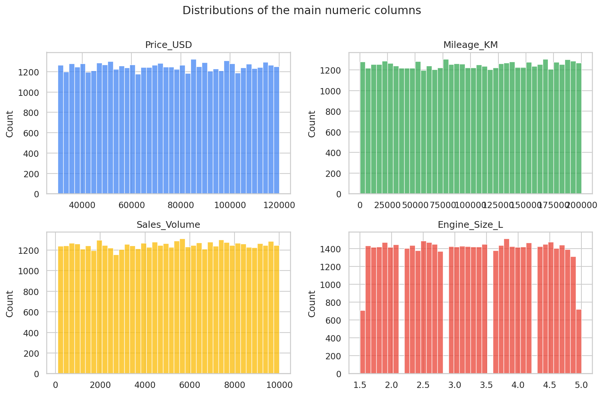
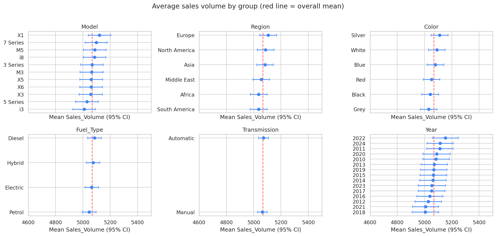
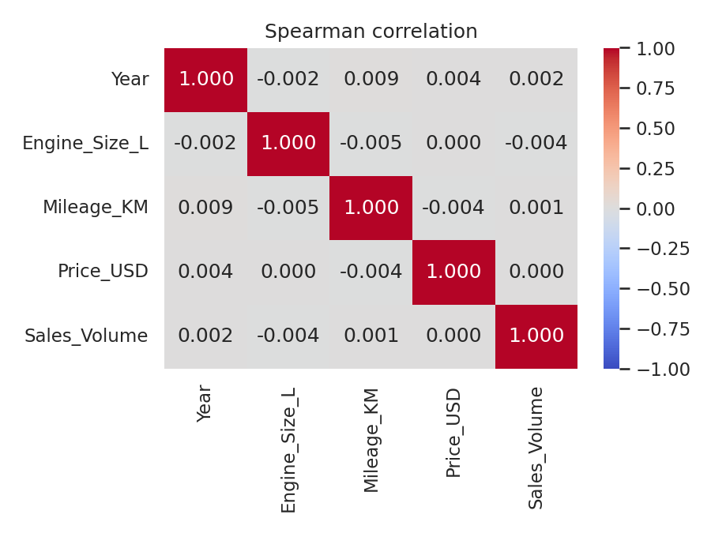
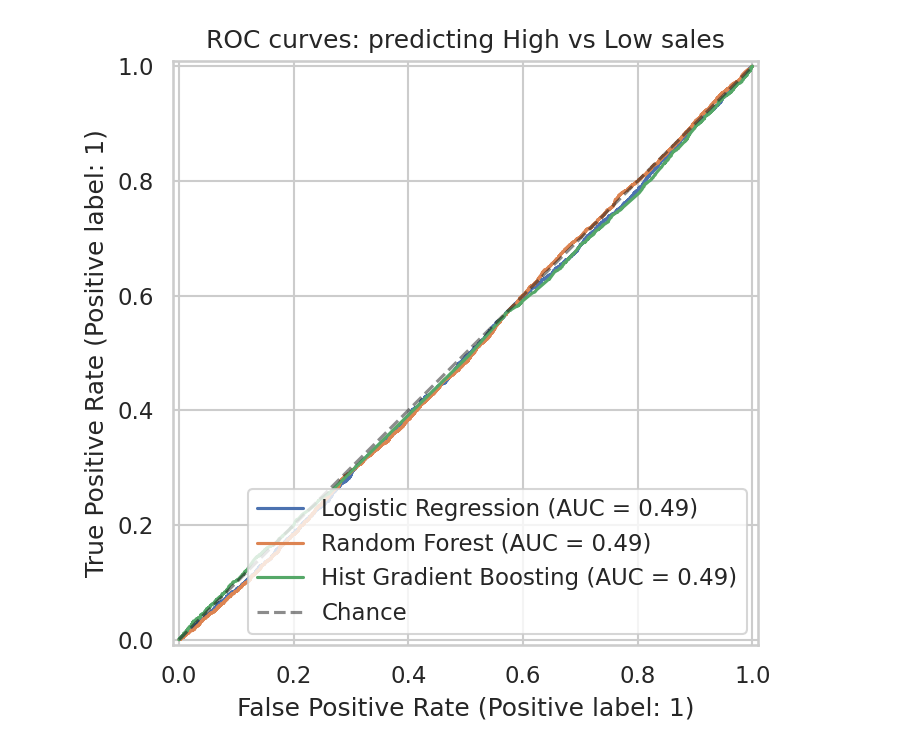

# BMW Sales Data Audit: Does the Data Support Business Conclusions?

A statistical audit of a 50,000-row BMW sales dataset (2010–2024). Before building any dashboard or model, the notebook checks the data for quality problems and tests whether vehicle attributes (model, region, fuel type, price, mileage, ...) explain sales at all.

**Result in one line:** they do not. Every test finds no relationship, and several patterns suggest the data was randomly generated, so it should not be used to draw business conclusions.

## Key findings

| Check | Result |
|---|---|
| Missing values / duplicate rows | 0 / 0 |
| How `Sales_Classification` is defined | **High if `Sales_Volume` ≥ 7,000, otherwise Low** (matches 100% of rows; 30.5% High) |
| Distribution of price, mileage, sales volume | Flat, consistent with a uniform distribution (KS test p = 0.99, 0.26, 0.16) |
| Electric cars | All 12,471 electric cars list a combustion engine size of 1.5–5.0 L (mean 3.24 L, same as petrol at 3.25 L) |
| Model vs. fuel type | Every model is split almost evenly across diesel, electric, hybrid, and petrol (about 25% each), including the i3 and i8 |
| Correlation with `Sales_Volume` (Spearman) | Year 0.002, engine size −0.004, mileage 0.001, price 0.000 (all p > 0.37) |
| Group differences in `Sales_Volume` (Kruskal-Wallis) | Model p = 0.87, region 0.50, color 0.42, fuel 0.73, transmission 0.74, year 0.81 |
| High vs. Low share by group (chi-square) | Between 29.4% and 32.3% in every group of every attribute (all p > 0.22) |
| Predicting High vs. Low from attributes | ROC-AUC 0.49–0.50 for all models (chance level); accuracy 69.5% equals always predicting Low |
| Same model with `Sales_Volume` as a feature | Accuracy and ROC-AUC 1.0, caused by **target leakage** (the label is a rule on that column) |

### Model results (20% test set, 5-fold CV where noted)

| Model | Accuracy | F1 (High) | ROC-AUC |
|---|---|---|---|
| Dummy (always Low) | 0.695 | 0.00 | 0.500 |
| Logistic Regression | 0.695 | 0.00 | 0.490 (CV 0.499) |
| Random Forest | 0.695 | 0.00 | 0.494 |
| Hist Gradient Boosting | 0.695 | 0.00 | 0.493 (CV 0.499) |

## Figures






## What this means

- Any dashboard of this data (best-selling model, best region, trend over time) would show differences caused only by random noise. The average sales volume of every model, region, color, fuel type, and year is within about 2% of the overall average of 5,068.
- The data cannot answer questions like "which BMW model sells best?" or "does price affect sales?". A real sales dataset is needed for that.
- The 100% accuracy from a model that includes `Sales_Volume` is not a result. It is a reminder to check how a target is built before modeling.

I cannot verify how the dataset was created. The evidence above is consistent with synthetic data, not proof of it.

## What this project shows

- Data validation before analysis (target definition, distribution checks, implausible combinations)
- Hypothesis testing: Spearman correlation, Kruskal-Wallis, chi-square, with effect sizes
- Machine learning with a benchmark, cross-validation, and a leakage demonstration
- Reporting a negative result honestly

## Data

- **Source:** [BMW Global Sales Dataset (2010–2024)](https://www.kaggle.com/datasets/ayeshaseherr/bmw-dataset) by ayeshaseherr on Kaggle
- **License:** [add license from the Kaggle page]
- 50,000 rows, 11 columns: `Model`, `Year`, `Region`, `Color`, `Fuel_Type`, `Transmission`, `Engine_Size_L`, `Mileage_KM`, `Price_USD`, `Sales_Volume`, `Sales_Classification`
- The data is not redistributed in this repository.

## Limitations

- The audit covers this one file, and its origin could not be verified.
- Tests treat rows as independent observations; the file has no row identifiers or dates beyond the model year.
- Models use default settings. With no signal in the data, tuning would not change the conclusion.

## Repository structure

```
├── notebooks/   bmw_sales_data_audit.ipynb
├── images/      result figures
└── README.md
```

## How to run

1. Download the dataset from Kaggle.
2. Open `notebooks/bmw_sales_data_audit.ipynb` in Google Colab and upload the CSV file to the session (any file name containing "BMW").
3. Run all cells (Runtime → Run all).

## Tools

Python · pandas · SciPy · scikit-learn · seaborn · matplotlib

## Author

**Nalendra Whisnu Pinilih**
Information Systems graduate, Universitas Dian Nuswantoro · BNSP-certified Associate Data Scientist
[GitHub](https://github.com/nalendra-wp) · nalendrawp@gmail.com
